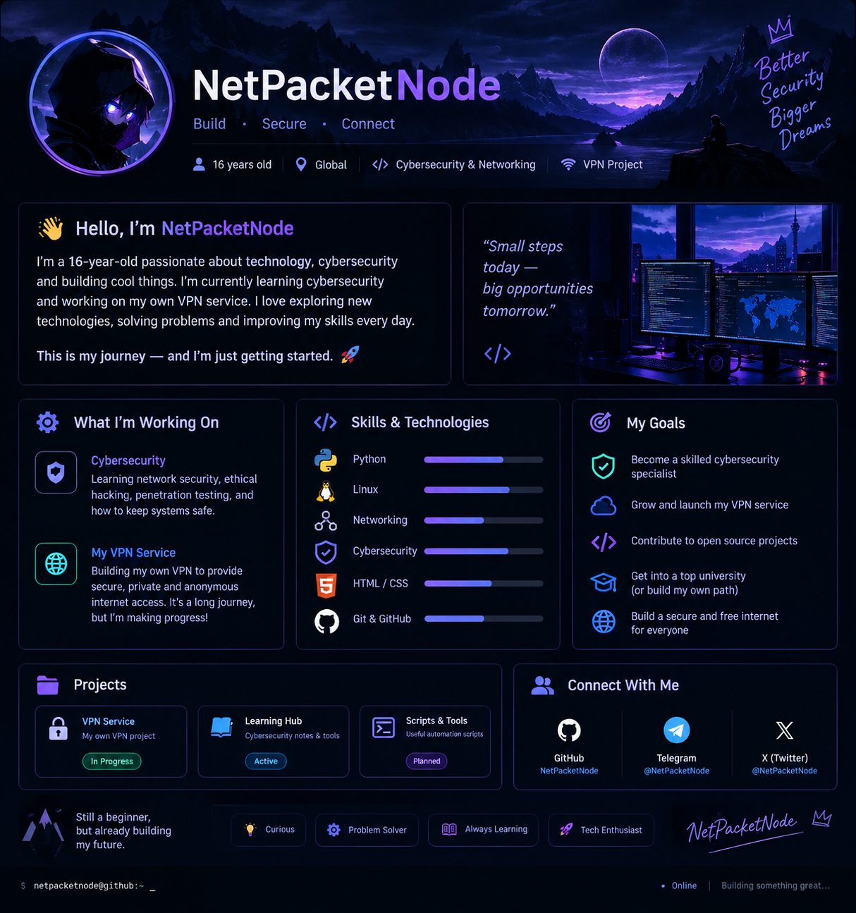

<!--
  NetPacketNode — GitHub Profile README
  1. Create a public repository named exactly: NetPacketNode
  2. Upload this README.md and the assets/ folder.
  3. Replace the social links and project URLs with your real ones.
-->

 

### 🛡️ Learning Cybersecurity • Exploring Networks • Building a VPN

*“Small steps today. Stronger systems tomorrow.”* 🌌

---

## 👋 Hey, I'm NetPacketNode!

I'm **16**, curious about how technology works under the hood, and starting my journey into **cybersecurity**. I'm learning, experimenting in legal lab environments, and building projects that help me understand networks and privacy.

Right now, I'm also working toward launching my own **VPN service** — learning about secure networking, privacy, infrastructure, and what it takes to build something reliable.

> 🚀 I'm at the beginning of the journey, but I'm here to learn consistently, build in public, and improve one project at a time.

## 🎯 What I'm focused on

| 🧭 Area | 🔍 What I'm exploring |
|---|---|
| 🛡️ Cybersecurity | Security fundamentals, threat awareness, and defensive practices |
| 🌐 Networking | TCP/IP, DNS, routing, VPN protocols, and network troubleshooting |
| 🐧 Linux | Command line, system administration, and lab environments |
| 🔐 Privacy & VPN | Learning how encrypted tunnels, servers, and privacy-friendly services work |
| 🧰 Scripting | Building small tools to automate tasks and understand systems |

## 🧪 Current projects

### 🌐 VPN Service — *In progress*
Exploring the foundations of a privacy-focused VPN service, from networking concepts to deployment and security. Still a work in progress — details will be added as the project develops.

### 📚 Cybersecurity Learning Lab
A collection of notes, experiments, and practice projects focused on learning security responsibly in systems I own or have permission to test.

### ⚙️ Scripts & Small Tools
Small utilities and experiments created along the way. I'll publish projects here as they become useful, documented, and ready to share.

> 📌 Project names and descriptions are a roadmap; link each title to its repository once it is published.

## 🧰 Technologies I'm learning

*These are learning areas, not claims of professional expertise. I'll update this section as I gain hands-on experience.*

## 🗺️ My roadmap

- [ ] 🐧 Get comfortable with Linux and the command line
- [ ] 🌐 Build a strong foundation in networking and TCP/IP
- [ ] 🐍 Learn Python for scripting and automation
- [ ] 🛡️ Practice defensive security and ethical hacking in legal labs
- [ ] 🔐 Understand VPN protocols, server hardening, and privacy fundamentals
- [ ] 📖 Document my learning and publish well-explained projects
- [ ] 🤝 Contribute to open-source projects

## 🤝 A little about how I work

- 🔎 **Curious by default** — I like understanding why something works, not just copying commands.
- 📈 **Learning in public** — documenting progress, mistakes, and lessons.
- 🧪 **Hands-on mindset** — turning concepts into small experiments and projects.
- 🛡️ **Responsible security** — testing only in authorized environments and respecting privacy.
- 🌱 **Long-term thinking** — building solid fundamentals before chasing advanced tools.

## 📬 Connect

For now, GitHub is the best place to follow my progress. Add your Telegram, email, website, or other public links here when you're ready — don't publish private contact information.

---

### ⚡ Build. Secure. Connect.

*Every expert started as a beginner. This is my starting point.*

🟣 **NetPacketNode** · *Learning today, building for tomorrow.*

